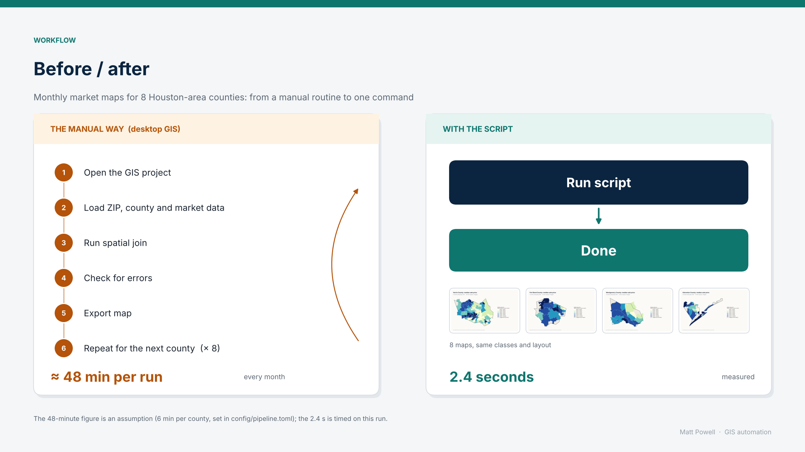
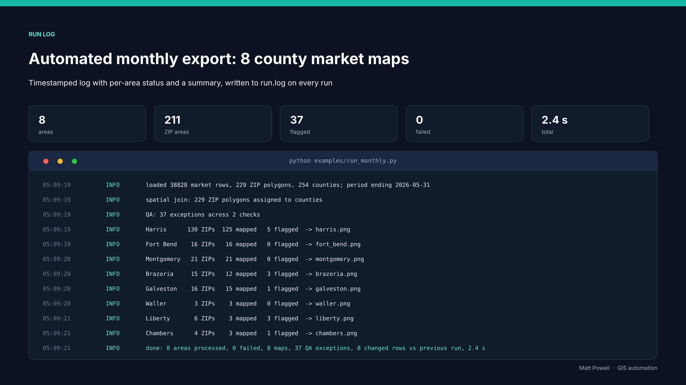
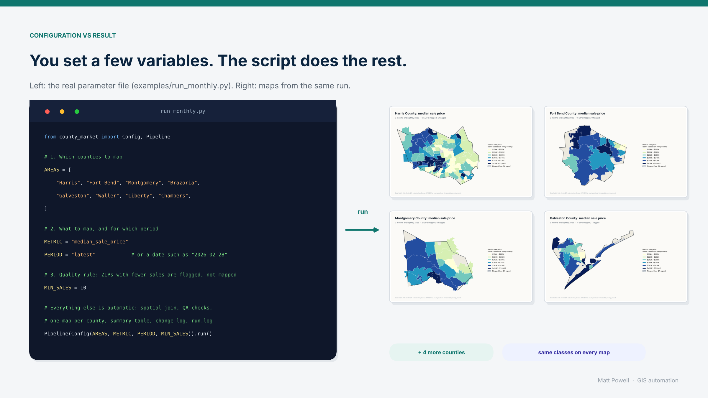
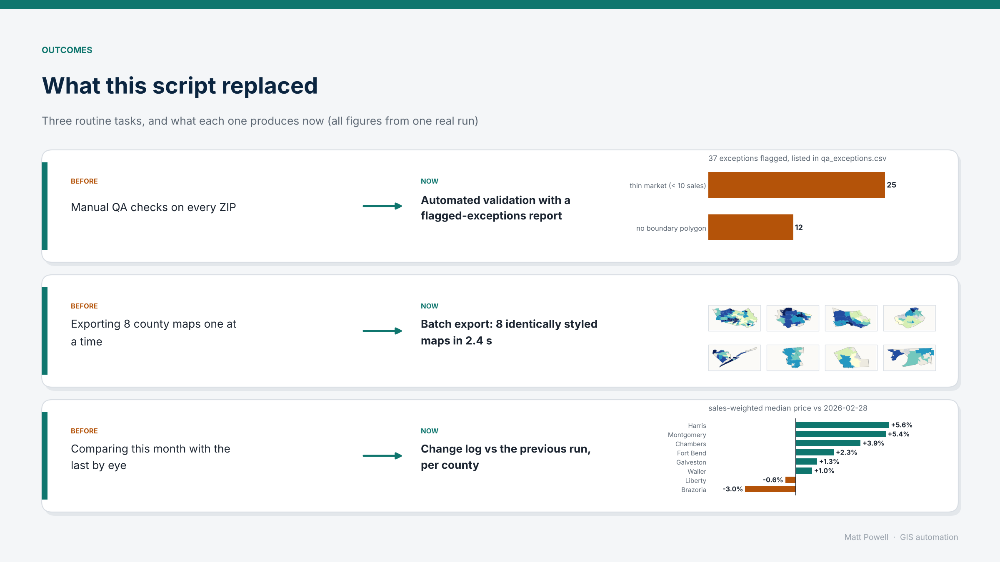
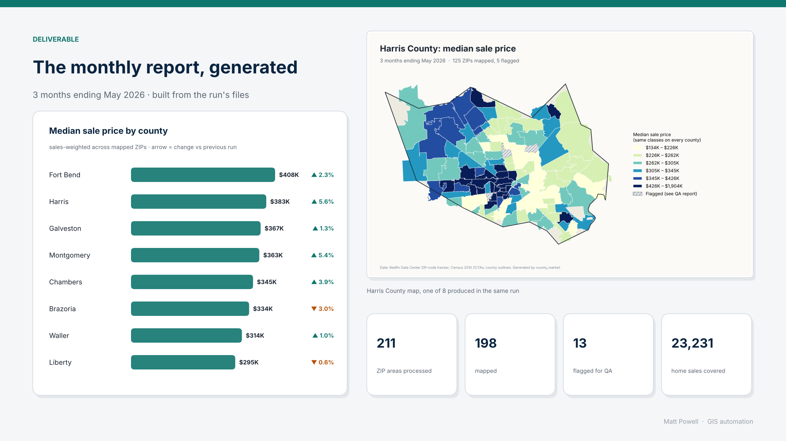

# GIS Automation

Portfolio project: a free, open-source pipeline (Python, GeoPandas, Matplotlib; no ArcGIS needed) that turns one config file into a full set of
county market maps, a QA report and a change log. The graphics below show what the automation does for a client, not what the code looks like.

**The job:** monthly home-price maps for 8 Houston-area counties from public data (Redfin ZIP-code tracker, Census ZCTAs, county outlines).
Join ZIPs to counties, run quality checks, export one consistently styled map per county, compare with the previous run.

## 1. Before / after


## 2. A successful batch run


## 3. A few variables in, finished maps out


## 4. What it replaced


## 5. The generated monthly report


## What is measured and what is assumed
- Measured: run time (2.6 s for 8 counties on the build machine), ZIP counts, QA exception counts, the change log, the log lines in image 2, the code in image 3, the report in image 5. All are read from the run's files by `scripts/make_portfolio.py`.
- **Assumed:** the "by hand" time (6 minutes per county, set in `config/pipeline.toml`). It is an illustrative estimate of doing the same job in a desktop GIS, not a timed measurement. Change it to your own figure.
- The terminal graphic is a render of the real `run.log`, not a screenshot.

## Run it
```bash
pip install -r requirements.txt
PYTHONPATH=src python examples/run_monthly.py              # the parameter file shown in image 3
PYTHONPATH=src python -m county_market                      # same job, driven by config/pipeline.toml
PYTHONPATH=src python -m county_market --period-end 2026-02-28
python scripts/make_portfolio.py                            # rebuild the five graphics from the latest run
```
Outputs per run: `outputs/runs/<period>/maps/*.png`, `summary.csv`, `qa_exceptions.csv`, `changes_vs_previous.csv`, `run.log`.

## Data and limits
Redfin Data Center ZIP tracker (rolling 3-month windows), Census 2010 ZCTA polygons (newer ZIPs have no polygon and are flagged), county outlines.
ZIPs with fewer than 10 sales are flagged, not mapped. ZIPs are postal areas, not neighborhoods.
